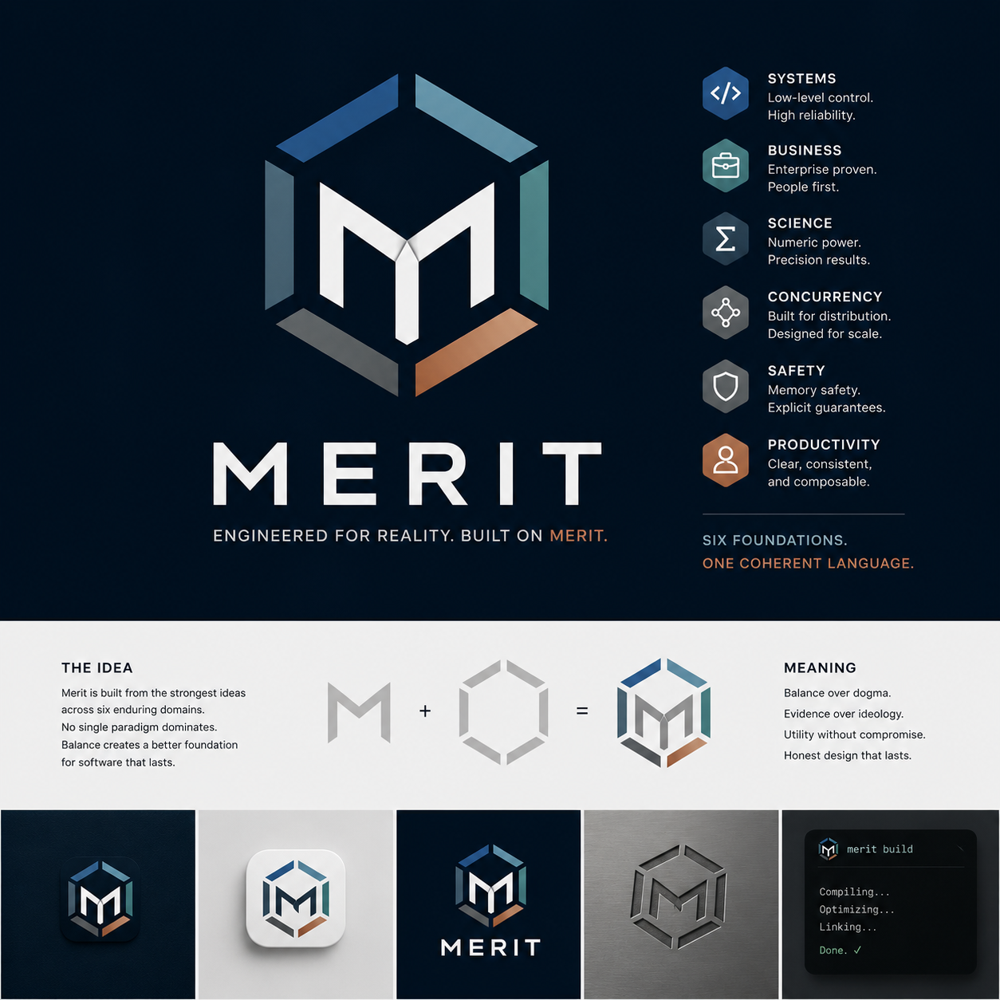

# Merit — Deterministic Systems Language

<p align="center">
  
</p>

Merit is a native compiled language experiment centered on deterministic semantics, exact numerics, ownership, explicit allocation, contracts, stable layouts, capability-specific hazardous operations, and C interoperability.

## Programming manual

Start with the [`docs/manual`](docs/manual/README.md) programming manual for user-facing language guidance, including ownership/borrowing, traits/generics, capabilities, and contracts.

## Design philosophy and rationale

Merit is being designed for **semantic longevity**: program meaning and language guarantees should remain stable while compiler algorithms, proof machinery, optimizers, code generators, and hardware targets remain free to evolve.

- [`docs/philosophy/SEMANTIC_LONGEVITY.md`](docs/philosophy/SEMANTIC_LONGEVITY.md) — the long-term rule: **freeze meaning, evolve implementation**.
- [`docs/philosophy/DESIGN_PRINCIPLES.md`](docs/philosophy/DESIGN_PRINCIPLES.md) — engineering criteria for deciding what belongs in Merit's permanent language surface.
- [`docs/rationale/LANGUAGE_STRATEGY.md`](docs/rationale/LANGUAGE_STRATEGY.md) — lessons Merit draws from COBOL, C, C++, Java, C#, Rust, Ada/SPARK, Fortran, and functional/ML-family languages.
- [`docs/migration/COBOL_MODERNIZATION.md`](docs/migration/COBOL_MODERNIZATION.md) — why COBOL modernization is difficult, what the current financial/copybook examples demonstrate, and how Merit separates enduring business semantics from legacy physical representation.

These documents describe design goals and constraints. Claims about performance, migration cost, productivity, or defect reduction should be supported by benchmarks and real migration evidence rather than inferred from the philosophy alone.

For continued development, start with:

- `AGENTS.md` — repository rules, invariants, and development loop
- `SELF_HOSTING.md` — merged SH5 evidence and active SH6 qualification ledger
- `POST_ALPHA2_CLEANUP.md` — completed bounded cleanup evidence ledger
- `STATUS.md` — current project and replacement-compiler state
- `ROADMAP.md` — active critical path and later work
- `BOOTSTRAP_STATUS.md` — detailed replacement-compiler checkpoint
- `CODEX_HANDOFF.md` — accumulated implementation history and architecture
- `LIMITATIONS.md` — deliberately unsupported first-alpha behavior

## Baseline

```bash
./scripts/bootstrap.sh
./scripts/test.sh
bash scripts/ci.sh
```

The completed `v0.1.0-alpha.1` release is followed by the completed and tagged
`v0.1.0-alpha.2` release. Automatic GitHub pull-request checks run a bounded
short gate on Ubuntu and native Windows. The canonical long corpus,
replacement-acceptance, reproducibility, self-hosting, and full gates are
deliberately dispatched for milestone qualification. Exact counts remain
checkpoint evidence rather than a frozen README promise.

## Current replacement checkpoint

The Python-hosted compiler remains the independent semantic oracle. The trusted
Merit-native production compiler carries source-backed resolved functions with
contracts, ownership/control-flow metadata, capability identities, and source
provenance.

The Merit-native compiler emits versioned v4 canonical MIR, C, and public-header
artifacts. The host validates source digests and artifact framing, then invokes
the external C toolchain without Python semantic or backend fallback. Python
retains independent reference/oracle implementations for differential evidence.

The concrete native driver covers M1-M10: the complete accepted/rejected Alpha.1
corpus, all ten acceptance applications, default production-path cutover, and
clean stage reproducibility. PR #115 closed the trust gate, and PR #116 closed
the release audit with authoritative Ubuntu and native-Windows evidence before
the `v0.1.0-alpha.2` tag. See `ALPHA2_CLOSURE.md` for historical release
evidence and `POST_ALPHA2_CLEANUP.md` for the completed cleanup evidence.
SH5 merged in PR #134: isolated stage 1 and stage 2 builds use only the public
project command and agree on canonical artifacts, protocol, diagnostics, fixed
accepted/rejected corpus, and all ten acceptance applications. SH6 clean
cross-platform qualification remains open in `SELF_HOSTING.md`.

## Established language surface

The stable alpha reference implementation includes exact fixed-scale decimals, bounded/checked integers, ownership and deterministic destruction, explicit allocation, contracts, capability auditing, stable layouts/C interoperability, multi-module projects, payload enums and typed propagation, strings and owned buffers, coherent traits, explicitly instantiated generics, generic `Vec<T>` collections, filesystem capabilities, structured source diagnostics, and interpreter/native differential verification within the documented limits.

Generic syntax includes explicitly instantiated generic structs, payload enums, and functions with compiler-defined bounds:

```merit
struct Pair<T, U> {
    first: T;
    second: U;
}

enum Option<T> {
    Some(T),
    None
}

fn maximum<T: Ord>(left: T, right: T) -> T {
    if (left >= right) { return left; }
    return right;
}
```

Both compiler paths preserve concrete-before-MIR monomorphization and the same
documented semantic, ownership, and backend contracts rather than defining
parallel languages.

## CLI

```bash
merit check program.mrt
merit verify program.mrt
merit layout program.mrt
merit audit program.mrt
merit-project check PATH --compiler-path EXECUTABLE
merit-project build PATH --compiler-path EXECUTABLE
merit-project run PATH --compiler-path EXECUTABLE
merit-project layout PATH --compiler reference
merit-project audit PATH --compiler reference
merit-project prepare-replacement PATH --compiler-path EXECUTABLE
merit-project verify PATH --compiler reference
merit-project build compiler --compiler-path STAGE0 -o STAGE1
merit-project build compiler --compiler-path STAGE1 -o STAGE2
```

`merit-project` selects replacement compilation by default. It discovers the
native frontend from `--compiler-path`, `MERIT_REPLACEMENT_DRIVER`, or
`merit-replacement-frontend` on `PATH`; `--replacement-driver` remains a
compatibility alias. The explicit stage commands above use the ordinary
`compiler/Merit.toml` project and produce directly usable executables without a
private bootstrap build step. Replacement mode fails closed and never silently
uses Python semantics. `verify`, `layout`, and `audit` are reference/oracle
tools and require explicit `--compiler reference`. The single-file `merit`
interface remains the documented independent reference compiler, not the
normal production project path.

---

The previous release README is retained as `README.previous.md` for historical detail.
